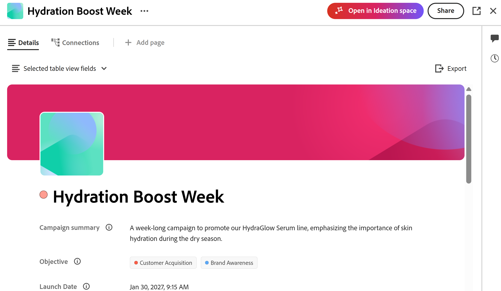
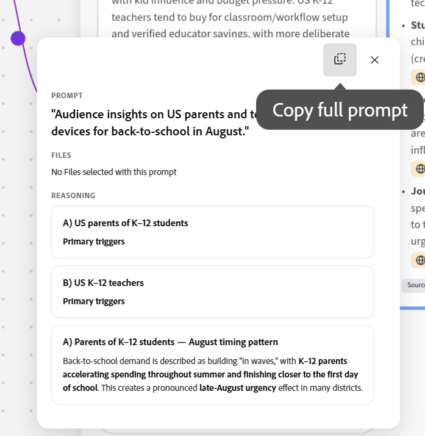

# Erstellen von Briefs im Ideationsbereich

<!--add to TOC and miniTOC-->

Die Informationen auf dieser Seite beziehen sich auf Funktionen, die noch nicht allgemein verfügbar sind. Es ist nur im Rahmen des Programms **Ideation Space Beta** verfügbar. 

Weitere Informationen finden Sie unter [Erste Schritte mit Ideationsplatzierungen für Adobe Workfront Planning](/help/quicksilver/planning/ideation/get-started-with-planning-ideation.md).

>[!IMPORTANT]
>
>Die Informationen in diesem Artikel beziehen sich auf Funktionen, die nur für Workfront-Kunden verfügbar sind, die auch über Adobe Workfront Planning verfügen. Ihr Unternehmen muss ein zusätzliches Planungspaket erwerben.
>
>Die hier beschriebene Funktion ist nicht verfügbar, wenn Ihr Unternehmen Workfront Planning als eigenständiges Produkt erworben hat.
>
>Allgemeine Informationen zu Workfront Planning finden Sie unter [Erste Schritte mit Adobe Workfront Planning](/help/quicksilver/planning/general/planning-overview.md).
> 
>

<!--
Future - when they make it available in Planning: replace the above with this OR ... insert the snippet:

>[!IMPORTANT]
>
>The information in this article refers to Adobe Workfront Planning which your organization can purchase either as an Adobe Workfront package or a standalone product. 
>
>Not all capabilities included in the Planning package are available to Workfront Planning when it is purchased as a standalone product. 
>
>For general information about Workfront Planning, see [Get started with Adobe Workfront Planning](/help/quicksilver/planning/general/planning-overview.md).
> 
>For information about Workfront Planning as a standalone product, see [Get started with Adobe Workfront Planning as a standalone product](/help/quicksilver/planning/planning-sta/planning-sta-overview.md). 
>
-->

Mit der Ideation Space, einer neuen Funktion von Adobe Workfront Planning, können Sie Briefs in Planungsdatensätze umwandeln oder als externe Datei speichern. Exportierte Briefs erstellen neue Datensätze oder aktualisieren vorhandene.

In diesem Artikel wird beschrieben, wie Sie im Ideationsbereich Ideen diskutieren und Strategien entwickeln können, um Briefs zu erstellen.

Sie können Folgendes tun:

* Um Datensätze zu erstellen oder zu aktualisieren, exportieren Sie fertige Ideenbeschreibungen in Workfront Planning.

* Um die Kurzinformationen in einem anderen Programm zu verwenden, exportieren Sie sie in einen der folgenden Dateitypen:

  * PDF
  * Wort
  * PowerPoint
  * PowerPoint-Vorlage

## Zugriffsanforderungen

+++ Erweitern Sie , um die Zugriffsanforderungen für die Funktion in diesem Artikel anzuzeigen. 

<!--
are there additional license restrictions or packages to be purchased to have access to Ideation space?? If yes, update the table below
-->

<table style="table-layout:auto"> 
<col> 
</col> 
<col> 
</col> 
<tbody> 
    <tr> 
<tr> 
</tr> 
<tr> 
   <td role="rowheader">
Cloud-Anbieteranforderungen
</td> 
   <td>
Amazon Web Services (AWS)

   
<b>HINWEIS:</b>

   
Wir unterstützen keine anderen Cloud-Anbieter.

   </td> 
  </tr>
<tr> 
   <td role="rowheader">
Adobe Workfront-Paket
</td> 
   <td> 
<ul> 
<li>
Beliebiger Workflow mit einem Planungspaket
</li>
<!--
Add this at GA - not available in beta:
Or
<li>
Any Planning package when purchased as a standalone product
</li>
-->
</ul>
   </td> 
<!--
<tr> 
<td role="rowheader">
Additional products
</td> 
<td><ul>
<li>
Adobe GenStudio for Performance Marketing
</li>
<li>
Adobe Customer Journey Analytics
</li>
</ul>
</td> 
</tr> 
-->
<tr> 
   <td role="rowheader">
Systemanforderungen
</td> 
   <td>
Die Einstellungen für Kollegen und MCP in Ihren Systemeinstellungen im Bereich Setup müssen aktiviert sein.

   </td> 
  </tr> 
  <tr> 
   <td role="rowheader">
Adobe Workflow-Lizenz
</td> 
   <td>
Standard

   </td> 
  </tr> 
<tr> 
   <td role="rowheader">
Adobe Planning-Lizenz
</td> 
   <td>
Standard

   </td> 
  </tr>  
<tr> 
   <td role="rowheader">
Konfiguration der Zugriffsebene
</td> 
   <td> 
   <ul>
   <li>
Sie müssen der Zugriffsebene sowohl einen Workflow- als auch einen Planning-Lizenztyp hinzufügen <!--when you have both a Workflow and a Planning package-->
   </li>
   <li>
Die Einstellung Ideenraum deaktivieren in Ihrer Zugriffsebene muss deaktiviert sein
</li>
   <li>
Die Einstellung CX Coworker-Bedienfeld in Workfront deaktivieren in Ihrer Zugriffsebene muss deaktiviert sein
</li></ul>
</td> 
  </tr>  
   <tr> 
   <td role="rowheader">
Objektberechtigungen
</td> 
   <td> 
Tragen Sie Berechtigungen oder höhere Berechtigungen zum Arbeitsbereich und Datensatztyp bei, dem Sie Datensätze hinzufügen möchten 

      
Systemadministratoren haben Berechtigungen für alle Arbeitsbereiche, einschließlich der nicht erstellten

      <!--
      not available right now:
      
View permissions to Workfront objects to add them to briefs 

      -->
      
Editor-Berechtigungen für den Ideenraum zum Erstellen von Briefs

   </td> 
  </tr>  
    <!--
    <tr> 
    <td role="rowheader">
Adobe GenStudio for Performance Marketing user roles
</td> 
    <td>
<ul><li>Any GenStudio user role to access Campaigns, Products, and Personas</li>
    <li>GenStudio System Manager to access Activations and Events</li></ul>
    For information, see <a href="https://experienceleague.adobe.com/en/docs/genstudio-for-performance-marketing/user-guide/intro/user-roles">User roles and permissions</a>. 
    

    </td> 
    </tr> 
    -->
</tbody> 
</table>

Weitere Informationen zu Zugriffsanforderungen für Workfront finden Sie unter [Zugriffsanforderungen in der Dokumentation zu Workfront](/help/quicksilver/administration-and-setup/add-users/access-levels-and-object-permissions/access-level-requirements-in-documentation.md).

+++  

## Erstellen von Ideen-Space-Briefs

Sie können Briefs erstellen, um Planungsdatensätze zu erstellen oder zu bearbeiten oder um Dateien zu erstellen, die Sie in andere Programme exportieren können.

1. Melden Sie sich bei Workfront mit Planning an, wo der -Mitarbeiter aktiviert wurde, und führen Sie einen der folgenden Schritte aus, um den Ideationsbereich zum ersten Mal zu öffnen und Briefs zu erstellen:

   * Navigieren Sie zum **Hauptmenü**  und klicken Sie auf **Ideationsraum**

     

   * Wechseln Sie zu **Hauptmenü**  > **Planung** > klicken Sie auf einen Arbeitsbereich > klicken Sie auf einen Datensatztyp > klicken Sie auf **Neuer Datensatz** > klicken Sie auf **Ideationsbereich starten**

     

   * Gehen Sie zu **Hauptmenü**  > **Planung** > klicken Sie auf einen Arbeitsbereich > klicken Sie auf einen Datensatztyp > klicken Sie auf einen vorhandenen Datensatz > klicken Sie auf **Öffnen Sie im Ideationsbereich**

     

1. Lesen Sie die Beta-Vereinbarung und klicken Sie auf **Zustimmen**. Sie müssen die Vereinbarung unterzeichnen, um Ideation Space zu nutzen.

   Die Arbeitsfläche „Ideationsraum“ wird geöffnet und eine neue Idee erhält standardmäßig den Titel nach dem folgenden Format:

   `catalyze-canvas-< number > - Month date, year at time` <!--submitted bug to change the default name to "Untitled ideation"-->

   Weitere Informationen zur Erstellung von Datensätzen mithilfe von Ideation Space finden Sie unter [Erstellen von Planungsdatensätzen aus Ideation Space Briefs](/help/quicksilver/planning/ideation/create-records-in-ideation-space-for-planning.md).

1. (Bedingt) Um eine bestehende Zusammenfassung im Ideation-Bereich zu öffnen, melden Sie sich bei Workfront mit Planning an, wo der -Mitarbeiter aktiviert wurde, und führen Sie einen der folgenden Schritte aus:

   * Gehen Sie zu **Hauptmenü**  > **Planung** > klicken Sie auf einen Arbeitsbereich > klicken Sie auf einen Datensatztyp > klicken Sie auf einen vorhandenen Datensatz > **Öffnen Sie im Ideationsbereich**

     Der Ideenname entspricht dem Namen des Datensatzes.

1. (Empfohlen) Klicken Sie auf den Namen der Idee, um den Namen zu ändern, wenn Sie sie zum ersten Mal geöffnet haben.

1. (Bedingt und optional) Um einen anderen vorhandenen Ideationsraum zu öffnen, klicken Sie auf das Dropdown-Menü rechts neben dem Ideennamen, suchen Sie nach dem Namen und klicken Sie dann auf die Idee, wenn sie in der Liste angezeigt wird.

   Der **Ideationsraum** wird geöffnet und „Kollege“ wird rechts geöffnet.
1. Verwenden Sie die Eingabeaufforderung des Mitarbeiters, um die Art der Zusammenfassung zu beschreiben, die Sie erstellen möchten.

   Geben Sie zum Beispiel „Erstellen Sie eine Kampagne „Zurück zur Schule“ für Schüler der Klasse K-12, die durch den Monat August läuft, für Eltern und Lehrer in den USA ein“.  Um die Zusammenfassung so vollständig wie möglich zu gestalten, geben Sie so viele Informationen an, wie Sie für welche Art von Kampagne verfügbar haben, den Zeitplan, die Stakeholder, Validierungs-Checkpoints und andere Details.
1. (Optional) Klicken Sie auf das Symbol **+** im Eingabeaufforderungsfeld „Mitarbeiter“ und fügen Sie Informationen wie folgt hinzu:

   * **Befehle**: Verwenden Sie einen Befehl aus der Liste, um einen Kollegen zur Eingabe von Inhalten aufzufordern.
   * **Datei anhängen**: Hängen Sie eine Datei an das Eingabeaufforderungsfeld an, um sie oder ihre Informationen zur Ideenarbeitsfläche hinzuzufügen. Sie müssen Ihren Kollegen bitten, Karten basierend auf der Datei zu erstellen, um die Karten später an den Brief zu senden.
   * **Objekt referenzieren**: Wählen Sie ein Objekt aus der Liste aus, um in Ihrer Idee darauf zu verweisen. Das Objekt muss in Workfront vorhanden sein.

1. Klicken Sie auf die Eingabetaste.

1. Beantworten Sie die Fragen von einem Kollegen, um die Idee fortzusetzen, und klicken Sie dann auf **Senden**

   ODER

   Klicken Sie **Umfrage überspringen**, um weitere Fragen zu überspringen.

1. (Bedingt) Wenn ein Mitarbeiter anbietet, Karten für die Idee zu erstellen, antworten Sie **Ja**.

   Karten werden der Ideenarbeitsfläche hinzugefügt, und Sie können die Quellen für jede Karte anzeigen und entscheiden, welche Karte zu Ihrem Briefing hinzugefügt werden soll.

   >[!TIP]
   >
   >Sie können Dateien nicht direkt zur Zusammenfassung hinzufügen. Sie müssen die Dateiinformationen zuerst auf die Karten übertragen, die Sie an den Brief senden können.

1. Klicken Sie auf das **Suchen**-Symbol , um auf der Ideenarbeitsfläche nach Elementen zu suchen, und klicken Sie dann, wenn es in der Liste angezeigt wird, um dorthin zu navigieren.

1. (Optional) Klicken Sie **Quellen** am unteren Rand jeder Karte, um zu verstehen, wo die Informationen erfasst wurden.

   Informationen können entweder aus Workfront Planning oder dem Web importiert werden.

   Sie können auch auf das **Quellen**-Symbol  in der rechten oberen Ecke des Bereichs klicken, um eine Liste der Quellen für alle Karten im Bereich anzuzeigen.
1. (Optional) Klicken Sie **Kommentare**  in der oberen rechten Ecke des Bereichs und **@** Taggen Sie die anderen, um innerhalb des Bereichs mit dem Brainstorming zu beginnen.

   Benutzer erhalten eine E-Mail-Benachrichtigung über das Tag.
1. (Optional) Klicken Sie auf **Filter**-Symbol  innerhalb der Kommentarkarte, um Kommentare nach folgenden Kriterien zu filtern:

   * Prüfer
   * Zeitpunkt, zu dem der Kommentar hinzugefügt wurde
   * Status (wo der Kommentar aufgelöst wurde oder noch aussteht)
   * Ungelesen (zeigt nur ungelesene Kommentare an)
1. (Optional) Verwenden Sie die Symbole **Daumen hoch** oder **Daumen runter** auf einer Karte , um Feedback zur Genauigkeit der Informationen auf der Karte zu geben.
1. Klicken Sie auf eine Karte oder auf den Rahmen mit allen Karten und dann auf **Zu Zusammenfassung hinzufügen**, um ihre Informationen der Zusammenfassung hinzuzufügen.

   Workfront ordnet jedem Informationselement das Feld zu, in dem es am wahrscheinlichsten gespeichert wird.

   Beispielsweise werden Zeitleisten zu Datumsfeldern und Beschreibungen zu Absatzfeldern hinzugefügt.

1. (Bedingt) Klicken Sie auf eine Karte und dann auf **KI bitten an …**, um Ideen für den nächsten Schritt zu erhalten, bevor Sie die Informationen zur Zusammenfassung hinzufügen. Die Antworten werden im Kontext der Informationen der einzelnen Karten angezeigt.
1. Klicken Sie auf **Dokumente hinzufügen**-Symbol  in der linken oberen Ecke der Ideenarbeitsfläche, um Dokumente in den Bereich hochzuladen. Sie können neue Dokumente oder Dokumente hinzufügen, die Sie bereits zu dem zuvor eingefügten Bereich hinzugefügt haben.

   >[!TIP]
   >
   >Die Einstellung Dokumente muss aktiviert sein, damit auf Dokumente zugegriffen und sie in den Bereich hochgeladen werden können.
   >Weitere Informationen finden Sie im Abschnitt [Konfigurieren der Arbeitsfläche &#x200B;](#configure-the-ideation-space-canvas) Ideationsraum“ in diesem Artikel.
   > 
1. Klicken Sie auf das Symbol **Workfront Connected Planning-Datensätze hinzufügen**  und wählen Sie einen verbundenen Datensatztyp und dann einen Datensatz aus jedem Typ aus, um die Informationen dieses Datensatztyps zum ausgewählten Datensatztyp hinzuzufügen.

   Es wird eine Karte für den Datensatz erstellt, den Sie der Platzierung hinzufügen möchten. Der Datensatztyp wird in der oberen linken Ecke der Datensatzkarte angezeigt.

   >[!TIP]
   >
   >* Das Symbol **Workfront Connected Planning Records hinzufügen** ist nicht verfügbar, wenn Sie über das Hauptmenü auf den Ideationsbereich zugreifen, und die Zusammenfassung ist nicht mit einem Planning-Datensatz verbunden.
   >
   >* Es stehen nur verbundene Planungsdatensätze zur Verfügung, die der Arbeitsfläche des Ideationsraums als Kontext für Ihre Idee hinzugefügt werden können. Jede verbundene Datensatzkarte, die der Arbeitsfläche hinzugefügt wird, beeinflusst den Typ des erstellten Inhalts und verwendet diesen Kontext, sofern er bei Ihrer Idee verwendet wird.
   >
   >   Wenn Sie beispielsweise eine Kampagne erstellen möchten, die vorhandene Datensatztypen nutzen muss, fügen Sie diese Datensätze zu Ihrer Arbeitsfläche hinzu.

1. (Optional) Klicken Sie auf das **Mehr** Menü  auf der verbundenen Datensatzkarte und klicken Sie auf **In Workfront anzeigen**.

   Die Detailseite des Datensatzes wird in Workfront Planning auf einer anderen Browser-Registerkarte geöffnet.
1. (Optional) Wählen Sie den Ideenrahmen oder eine Karte aus, klicken Sie auf das Symbol **Löschen** und klicken Sie dann zur Bestätigung auf **Löschen**. Die Karte wird aus der Arbeitsfläche „Ideationsraum“ entfernt.

   Wenn Sie Karten löschen, die einem gespeicherten Dokument oder Datensatz entsprechen, werden die Elemente aus der Arbeitsfläche entfernt, bleiben jedoch in ihren jeweiligen Anwendungen.

1. (Optional) Verwenden Sie das **Mitarbeiter fragen** in der rechten unteren Ecke jederzeit, um Ihre Idee zu verfeinern.

   Geben Sie beispielsweise `regenerate` für eine bestimmte Karte ein, damit KI diese Karte unter Verwendung des aktualisierten Kontexts wiederholen kann. Der Ideenraum führt seine logischen Schritte (Suchen, Synthetisieren, Zitieren) erneut aus und aktualisiert die betroffenen Karten.

1. (Optional) Klicken Sie auf einen der lilafarbenen Connectoren aus beliebigen Ideenkartensätzen und klicken Sie dann auf das Symbol **Vollständige Eingabeaufforderung kopieren**, um die Eingabeaufforderung, die die Karte generiert hat, in die Zwischenablage zu kopieren, und fügen Sie sie dann in das Feld „Eingabeaufforderung für Mitarbeiter“ ein.

   

1. (Optional) Klicken Sie auf die **Rückgängig** oder **Wiederholen**-Symbole  oben auf der Arbeitsfläche, um eine Aktion abzubrechen oder rückgängig zu machen.
1. Zoomen Sie heran, um das vollständige Bild zu sehen: Ihr ursprüngliches Kampagnenziel, alle KI-generierten Konzeptkarten mit Zitaten, zusätzliche Dokumente, die echten Workfront-Planungsdatensätze, die Sie eingezogen haben (Produkte, Personas usw.). Die **Brief** Zusammenfassungskarte in der linken unteren Ecke zieht alles zusammen.

1. Klicken Sie auf das Bild für die Kurzvorschau in der linken unteren Ecke, prüfen Sie die Kurzvorschau und klicken Sie dann auf eine der folgenden Optionen:

   * **In Datei exportieren**. Sie können die Zusammenfassung in die folgenden Dateitypen exportieren:

     * PDF
     * Wort
     * PowerPoint (mit oder ohne Vorlage)
   * **In Workfront Planning exportieren**. Der Export überschreibt alle vorhandenen Felddaten im Planungsdatensatz entsprechend der Idee.

   >[!TIP]
   >
   >**In Workfront Planning exportieren** ist abgeblendet, wenn Sie über das Hauptmenü auf den Ideationsbereich zugreifen und die Zusammenfassung nicht mit einem Planungsdatensatz verbunden ist.

   Damit ist die Erstellung des Datensatzes oder der Datei mit den Zusatzinformationen abgeschlossen. Wenn Sie von einem vorhandenen Datensatz aus beginnen, werden die Informationen aus der Zusammenfassung zum Datensatz hinzugefügt. Wenn Sie mit einem neuen Datensatz beginnen, wird der Datensatz mit den Informationen in der Zusammenfassung erstellt.

   Weitere Informationen zur Aktualisierung von Planungsdatensätzen mithilfe von Briefs finden Sie im Abschnitt „Überlegungen zur Verwendung des Ideationsraums zur Erstellung von Datensätzen“ im Artikel [Erstellen von Planungsdatensätzen aus Ideationsraumbeschreibungen](/help/quicksilver/planning/ideation/create-records-in-ideation-space-for-planning.md).
1. (Optional) Klicken Sie auf **Freigeben**, um die Ideenarbeitsfläche mit anderen zu teilen.

   Weitere Informationen finden Sie unter [Ideen für andere freigeben](/help/quicksilver/planning/ideation/share-the-ideation-space.md).

## Konfigurieren der Arbeitsfläche für Ideationsraum

Es gibt Steuerelemente für den Ideationsbereich, mit denen Sie konfigurieren können, was Sie auf dem Bildschirm sehen, und Sie bei der Navigation auf der Arbeitsfläche unterstützen.

1. Klicken Sie auf das **Einstellungen**-Symbol , um zu steuern, woher KI Informationen abruft, und wählen Sie dann einen der folgenden **Source-Typen**:

   * **Dokumente** - Dokumente, die in den ausgewählten Bereich hochgeladen wurden
   * **Web Search** — externe Web-Forschung
   <!--
     **CJA** — Adobe Customer Journey Analytics
    -->
1. Klicken Sie auf **Speichern**.

1. Klicken Sie auf das **Zoomstufe** Dropdown-Menü links neben dem **Hilfe**-Symbol , um eine Option auszuwählen.

   Wählen Sie aus den folgenden Optionen:

   * **An Größe zoomen**
   * **Einzoomen**
   * **Verkleinern**
   * Zoomen Sie auf **50**, **100**, **150** oder **200%**
   * **Punktraster anzeigen**: Aktivieren Sie die Auswahl, um das Punktraster anzuzeigen.
   * **Produkttour**: Deaktivieren Sie die Auswahl, um sich von Leitungshinweisen bei der Verwendung von Ideation-Raum abzumelden.

1. Klicken Sie auf **Hilfe**-Symbol , um die Tastaturbefehle anzuzeigen, mit denen Sie auf der Arbeitsfläche navigieren oder einen anderen Zoom-Wert auswählen können:

| Aktion | Tastenkombination |
| --- | --- |
| Vergrößern/Verkleinern | Strg/⌘ + / − |
| Auf 100 % zoomen / | Strg/⌘ 1 / 1 |
| Auf 200 % zoomen / | Strg/⌘ 2 / 2 |
| An Fenstergröße anpassen | Strg/⌘ 0 / 0 |
| An Auswahl anpassen | Alt-Strg 0 |
| Zum Cursor zoomen | Strg/⌘ Bildlauf |
| Schwenk | Leertaste gedrückt halten |
| Punktraster ein-/ausblenden | GB |

<!--

    Once opened, the Ideation space agent goes through the following steps:

    1. **Data ingestion and synthesis**:  Pulls relevant information from connected sources. For example: 
    
        * Existing record types or the existing record type that you started from. 
        * Recent documents you might have uploaded in the ideation space. 
        * Web information that matches your prompt criteria.

            >[!TIP]
            >
            >The Web search setting must be turned on for AI to be able to look for information on the web.  
            >For information, see the section [Configure the Ideation space](#configure-the-ideation-space)in this article.
            >
    1. **Audience definition**: Identifies or recommends target audience parameters based on historical patterns
    1. **Strategy framing**: Structures the strategic narrative for the campaign
    1. **Messaging and concept ideation**: Generates initial message options and creative concept directions
    1. **Brief generation and planning handoff**: Produces a structured brief that feeds back into the Workfront Planning workspace

        When the Ideation agent finishes the process of collecting all the information, the following things occur: 
    
        * Five cards are created and are organized by relevant and like-information. 

            The cards are titled using various steps in the creation of the requested record, for easy recognition. 
    
            For example, they could be named:

            * Plan
            * Timeline
            * Segments
            * Mechanics  
            * Messaging 

        The cards titles are custom to each card in the ideation. 

        * The cards are placed inside the same frame indicating this is the result of one ideation. 

        * A brief is created and displays in a preview image in the lower-left corner of the Ideation space. <!
    
        The brief contains suggested fields that the system considers pertinent to the ideas you are exploring. 
-->

