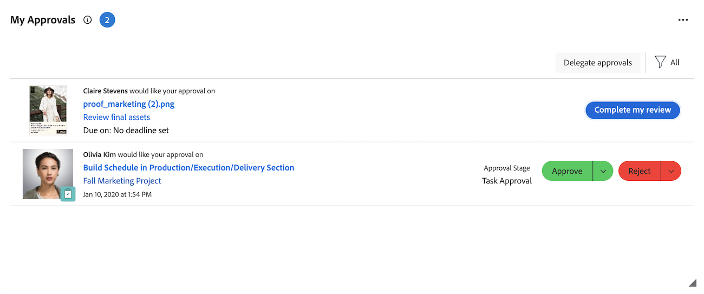

# Verwalten Ihrer Genehmigungen mit dem Widget „Meine Genehmigungen“

Das Widget Meine Genehmigungen zeigt alle ausstehenden, zugewiesenen, delegierten und gesendeten Genehmigungen an einer Stelle an. Hier können Sie Ihre Genehmigungen filtern und organisieren, Entscheidungen treffen und Genehmigungen nach Bedarf delegieren.

Das Widget Meine Genehmigungen unterstützt Genehmigungen von den folgenden Workfront-Objekten:

* Aufgaben
* Probleme
* Projekte
* Dokumente
* Korrekturabzüge
* Planen von Datensatzanfragen
* Arbeitszeittabellen

>[!NOTE]
>
>Wenn Ihr Unternehmen den Adobe-Cloud-Speicher verwendet, wird eine Dokumentgenehmigung im Widget nur angezeigt, wenn das Projekt, das das Dokument enthält, für Sie freigegeben wird.

## Zugriffsanforderungen

+++ Erweitern, um die Zugriffsanforderungen für die in diesem Artikel beschriebene Funktionalität anzuzeigen.

<table style="table-layout:auto"> 
 <col> 
 <col> 
 <tbody> 
  <tr> 
   <td role="rowheader">Adobe Workfront-Paket</td> 
   <td> 
Beliebig
 </td> 
  </tr> 
  <tr> 
   <td role="rowheader">Adobe Workfront-Lizenz</td> 
   <td> 
   
Mitwirkende oder höher

   
Überprüfen oder höher
 </td> 
  </tr> 
  <tr> 
   <td role="rowheader">Konfigurationen der Zugriffsebene</td> 
   <td> 
Zugriff auf Objekte, die mit Genehmigungen verknüpft sind, anzeigen oder höher
</td> 
  </tr> 
  <tr> 
   <td role="rowheader">Objektberechtigungen</td> 
   <td> 
Anzeigen von oder höheren Berechtigungen für die Objekte, die mit Genehmigungen verbunden sind
</td> 
  </tr> 
 </tbody> 
</table>

Weitere Informationen finden Sie unter [Zugriffsanforderungen](/help/quicksilver/administration-and-setup/add-users/access-levels-and-object-permissions/access-level-requirements-in-documentation.md) in der Dokumentation zu Workfront.

+++

## Genehmigen von Arbeit über das Widget Meine Genehmigungen

1. Klicken Sie oben rechts auf **[!UICONTROL Hauptmenü]**  und dann auf **[!UICONTROL Startseite]**.
1. (Bedingt) Klicken Sie auf **Anpassen**, um das Widget **Meine Genehmigungen** hinzuzufügen.
1. (Optional) Passen Sie die Filteroptionen im Widget Meine Genehmigungen an, um festzulegen, welche Genehmigungen angezeigt werden sollen. Die folgenden Filteroptionen sind verfügbar:

   | Filteroption | Beschreibung |
   |--------|-------------|
   | Alle | Zeigt alle Genehmigungen an, die Ihnen zugewiesen wurden, die von anderen Benutzern an Sie delegiert und von Ihnen eingereicht wurden. |
   | Meine Genehmigungen | Zeigt die Ihnen zugewiesenen Genehmigungen an. Dies ist die Standardoption. |
   | Delegierte Genehmigungen | Zeigt Genehmigungen an, die von anderen Benutzern an Sie delegiert wurden. |
   | Von mir gesendete Genehmigungen | Zeigt Genehmigungen an, die Sie an andere Benutzer weitergeleitet haben. |

   >[!NOTE]
   >
   >Genehmigungen, die Aufgabengebieten oder Gruppen zugewiesen wurden, werden nicht auf der Startseite angezeigt. Genehmigungen, die Teams zugewiesen wurden, werden für jedes Teammitglied im Widget Meine Genehmigungen angezeigt.

1. (Bedingt) Klicken Sie auf das **Sortieren** Dropdown-Menü und wählen Sie dann **Neueste zuerst**, um die zuletzt hinzugefügten Genehmigungen anzuzeigen.

1. (Optional) Klicken Sie auf das Vollbildsymbol  das Widget Meine Genehmigungen im Vollbildmodus zu öffnen.

1. Wählen Sie das Element aus, für das Sie eine Genehmigungsentscheidung treffen möchten.

   

   <!--update screenshot after production release-->

1. Klicken Sie im rechten Bedienfeld auf eine der verfügbaren Optionen, wenn Sie eine Genehmigungsentscheidung treffen. Die folgenden Optionen werden je nach Art des zu genehmigenden Elements in der rechten oberen Ecke der Seite angezeigt:

   <table>
   <tr>
      <td>
      
<strong>Zugriff</strong>

      </td>
      <td>
      
<strong>Arbeitselemente</strong>

      </td>
      <td>
      
<strong>Dokumente</strong>

      </td>
      <td>
      
<strong>Korrekturabzüge</strong>

      </td>
   </tr>
   <tr>
      <td>
       <ul>
      <li>erteilen</li>
      <li>Ignorieren</li>
      </ul>
      Sie können die Zugriffsebene bei Bedarf im Dropdown-Menü <b>Zugriff ändern</b> anpassen.
      </td>
      <td>
         <ul>
         <li>Genehmigen</li>
         <li>Ablehnen</li>
         </ul>
      Sie können eine Entscheidung kommentieren, indem Sie auf das Dropdown-Menü in der Entscheidungsschaltfläche klicken.
      </td>
      <td>
   Als genehmigende Person zugewiesen
         <ul>
         <li>Genehmigen</li>
         <li>Mit Änderungen genehmigt</li>
         <li>Muss bearbeitet werden</li>
         </ul>
   Als Prüfer zugewiesen
         <ul>
         <li>Überprüfung abschließen</li>
         </ul>
      Die Optionen in dieser Spalte gelten nur für einheitliche Genehmigungen. Legacy-Dokumentgenehmigungen erscheinen genauso wie Arbeitselementgenehmigungen. 
      </td>
      <td>
         <ul>
         <li>Zum Korrekturabzug gehen</li>
         </ul>
         Sie treffen Ihre Entscheidung in der Korrekturabzugsansicht. Informationen zur Überprüfung eines Korrekturabzugs finden Sie unter <a href="/help/quicksilver/review-and-approve-work/proofing/reviewing-proofs-within-workfront/review-proofs-in-wf.md">Testsendungen in Adobe Workfront </a>.
      </td>
   </tr>
   </table>

## Wenn Genehmigungen aus dem Widget entfernt werden

Eine Genehmigung wird aus dem Widget Meine Genehmigungen entfernt, nachdem Sie eine Entscheidung darüber getroffen haben. Genehmigungen werden auch in den folgenden Situationen entfernt:

* **Arbeitsgenehmigungen**: Genehmigungen für Projekte, Aufgaben und Probleme werden aus dem Widget entfernt, wenn das Projekt einen der folgenden Status aufweist:
  * Abgeschlossen
  * Eingestellt
  * Zurückgestellt

  >[!NOTE]
  >
  >Wenn für ein Projekt die Genehmigung aussteht, kann für die aktuellen genehmigenden Personen weiterhin die eigene Genehmigung des Projekts angezeigt werden. Genehmigungen für Aufgaben und Probleme werden jedoch nicht angezeigt.

* **Legacy-Dokumentgenehmigungen**: Legacy-Dokumentgenehmigungen werden aus dem Widget entfernt, basierend auf dem Status des Objekts, an das das Dokument direkt angehängt ist, und nicht auf einem übergeordneten Objekt. Die Genehmigung wird entfernt, wenn sich dieses Objekt in einem der folgenden Status befindet:
  * Projekt: Abgeschlossen oder Eingestellt
  * Aufgabe: Abgeschlossen
  * Problem: Geschlossen oder ein Status, der Geschlossen entspricht. Dazu gehören „Resolved“, „Won&#39;t Resolve“, „Cannot Duplicate“ und „Verified Complete“.

* **Einheitliche Genehmigungen**: Einheitliche Genehmigungen bleiben unabhängig vom Projekt-, Aufgaben- oder Problemstatus im Widget. Ihre Sichtbarkeit wird durch den Genehmigungs-Workflow und Ihre ausstehenden Genehmigungsaufgaben gesteuert, sodass eine Genehmigung aus dem Widget entfernt werden kann, bevor der gesamte Workflow abgeschlossen ist.

Benutzerdefinierte Status folgen der Gleichungen mit der Zuordnung, sodass ein Status, der einem der oben genannten Status entspricht, dasselbe Ergebnis erzielt. Die Genehmigung kann für das Objekt auch dann ausstehend bleiben, wenn es aus dem Widget entfernt wird. Weitere Informationen zu benutzerdefinierten Status finden Sie unter [Erstellen oder Bearbeiten eines Status](/help/quicksilver/administration-and-setup/customize-workfront/creating-custom-status-and-priority-labels/create-or-edit-a-status.md).
